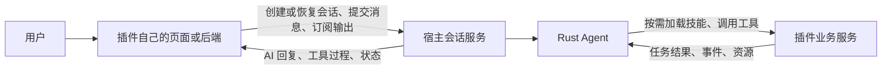

# 插件系统实施计划：DSH 协议兼容与双向 Agent 驱动

日期：2026-10-15

本文是后续实施与验收计划，不表示以下能力已经全部完成。D1 表示正式实施的第一个工作日，排期按连续投入估算。

## 1. 目标与优先级

建设参考 DSH/Cordis 的插件系统，使插件既能为宿主 Agent 提供技能、工具、页面和业务服务，也能从自己的页面或后端调用宿主 Agent。

插件可以作为独立项目、独立部署，保留自己的登录、权限、业务数据和前后端。Agent 的模型调用、对话上下文与历史由宿主管理。AI PPT 是第一个完整业务接入，代码 Flow 是内置插件样例，另用一个最小独立示例验证通用性。

长期目标是继承 DSH 的公开插件能力，尽量直接复用 DSH 插件。实施顺序明确如下：

1. **优先保持 DSH 通信协议兼容**，复用已有包络、方法契约、事件与流协议；先完成插件与宿主 Agent 的双向调用。
2. 完成 AI PPT 的迁移、测试、真实联调和部署验证。
3. 在后续阶段补充 Node.js 兼容运行环境、Cordis 宿主侧服务适配及原生 DSH 插件加载。

协议兼容、服务行为兼容、原生插件运行兼容分别验收。首阶段不以接通 HTTP 或生成几页 SVG 作为全部完成的依据，也不把通信兼容标注成所有 DSH 插件已经可以直接运行。

## 2. 双向驱动的含义

- 宿主驱动插件：Agent 发现并读取技能，取得相应工具，调用插件完成业务。
- 插件驱动宿主：插件在用户操作或已授权的业务触发下，调用宿主会话服务，启动或继续 Agent 工作轮次。
- “激活宿主”指驱动 Agent 会话；宿主服务需要已经运行。插件连接就绪不自动启动模型推理。
- 双向调用可以使用两个方向的受认证接口，不要求先建设对称 RPC 或新传输层。优先沿用 DSH 已有通信方式。
- PPT 工具完成事件首先是任务状态，不自动等同于用户确认或新的用户指令。

## 3. 已有基础与当前缺口

| 范围 | 已有基础 | 本轮需要完成 |
| --- | --- | --- |
| Rust 插件内核 | 作用域、服务依赖、贡献注册和卸载清理 | 核对 DSH 语义，补生命周期及故障回归 |
| 技能与工具 | 技能发现、按需读取、轮次内工具激活 | 纳入统一插件会话和版本变更规则 |
| 内置与本地外置 | 共同清单、内置目录、外置包及独立程序工具 | 保持既有能力，验证迁移与兼容 |
| 远程插件 | PPT 握手、工具、资源和事件适配 | 从 PPT 专用实现抽出通用连接与身份契约 |
| 插件页面 | Cordis 模块、iframe 和会话桥接 | 与独立站点共享会话服务及权限语义 |
| 独立站点 | AI PPT 原站前端已经接到宿主 Agent | 补通用后端调用入口，消除通用层的 PPT 特例 |
| PPT 业务 | 直接 SVG、工具异步任务、版本及导出链路 | 完整验证确认、多轮修改、视觉检查、导出与恢复 |
| 确认流程 | 已修复技能入口；隔离模型回放已验证停下与确认后继续 | 补真实页面、真实模型、真实工具的完整验收 |
| DSH 原生插件 | 前端已有 Cordis 基础源码与部分组件复用 | Node.js 宿主侧运行兼容留到后续阶段 |

当前远程实现使用了 DSH Connection 包络，但主要适配 PPT Remote 契约。现有 `plugin.json` 也不是完整 DSH npm 插件格式；两项都需要明确记录兼容范围。

## 4. DSH 兼容基线

首轮以本机 DSH 源码为可复现基线：

- 仓库：`/home/goodtime/project/deepseek-harness`
- Commit：`46a7f68b0922371ce7144b668b90e377d8e799f4`
- 后续升级单独记录版本和协议差异，保留来源及许可证。

重点对照：

| DSH 来源 | 对照内容 |
| --- | --- |
| `packages/client/connection/src/rpc.ts` | RPC 请求、响应、关联 ID、错误和二进制附件契约 |
| `packages/client/connection/src/rpc-host.ts` | 端点注册、连接及认证入口 |
| `packages/api/gateway/src/stream-protocol.ts` | 流的打开、数据、结束和取消 |
| `packages/api/session-controller/` | 创建、恢复、提交消息、历史和实时状态 |
| `packages/core/agent/` | Agent 句柄、输入、事件、作用域及释放语义 |
| `packages/skill/tool-skill/` | 技能发现与加载 |
| `packages/client/modules/` | 客户端模块声明、加载、共享依赖与清理 |
| `packages/boot/plugin-manager/` | 安装、启停、配置、重载及包管理；原生运行支持后置 |

D1 输出一份兼容清单，逐项标注：现成复用、已兼容、需要桥接、尚未实现，并附对应测试。DSH 已有的协议优先沿用；新增远程插件发现、握手、授权等字段通过明确的扩展和能力协商提供。

## 5. 首阶段设计与实现范围

### 5.1 统一插件身份、清单与生命周期

- 内置与外置遵守相同注册、依赖、权限、贡献归属和清理规则。
- 内置是显式项目成员，放在前后端内置插件目录，共享工程构建。
- 本地外置由安装器管理；下载到项目目录不改变其外置身份。
- 远程外置以服务地址连接，不下载业务项目到宿主。
- 加载、启用、连接就绪、技能激活、Agent 正在执行使用不同状态表达。
- 重载或卸载使旧页面、旧作用域和旧激活失效，定义进行中调用的处理方式。
- 宿主清理所属连接、监听器、页面和本地进程；远端后台任务按其取消契约处理，不能声称断连已取消任务。

### 5.2 通信协议兼容

- 保留 DSH 的 `client-request` / `server-response`、`rpcId` 和结果/错误结构。
- 对照已有 Remote 方法名、参数与返回类型；明确兼容版本和支持的子集。
- 流沿用 DSH 的 `open/item/end/cancel` 语义，验证顺序、结束及取消行为。
- 规范会话历史游标、业务事件游标和请求关联信息，避免混为一个序号空间。
- 资源与二进制传输优先复用 DSH 已有契约，不另造不兼容的编码方式。
- 明确受理成功、任务执行成功、连接就绪和用户确认的区别。
- 同一提交请求的重试能够返回原受理结果；不盲目重放已经产生业务副作用的工具。
- 首阶段用固定基线的真实 DSH Client/协议测试验证互通，不只测试自写客户端与自写服务端。

### 5.3 宿主向插件提供 Agent 服务

提供统一会话服务，支持创建、恢复、提交消息、读取历史、订阅输出、读取状态和取消。

- 独立插件前端和后端调用同一套服务语义。
- 会话绑定插件、已认证用户及业务资源；通用层不写死 PPT 项目字段和工具名。
- 业务资源使用插件命名空间下的标识，PPT 插件负责解释其项目 ID。
- 同一会话保留完整上下文和已确认决策；新一轮重新检查当前有效的技能及权限。
- 按授权范围提供宿主视觉等公共能力，业务插件无需复制一套 Agent。
- 保留调用来源、请求 ID、会话 ID、远端任务 ID，便于跨服务定位故障。
- 对正在执行的会话，明确重复提交、排队、取消及后续输入的处理规则；与拟兼容的 DSH 契约对齐。

### 5.4 握手、认证与能力边界

- 连接时确认协议版本、插件身份、声明能力、工具 schema、技能资源和页面入口。
- 明确宿主授予插件调用哪些服务，插件向 Agent 暴露哪些工具。
- 独立站点保留自己的登录；使用经验证的用户身份或受限授权驱动对应会话。
- 插件后端反向调用宿主有独立的认证与授权校验，不能仅凭插件 ID 或会话 ID 获得权限。
- 用户凭证不进入模型上下文、对话历史或公开清单。
- 业务服务继续检查用户和业务资源归属；宿主检查插件、会话和工具范围。
- 失效、撤销、换账号、重连及服务重启均有明确行为。
- 插件会话不能借助前端参数、提示词或权限模式切换取得其他插件及宿主开发工具。

### 5.5 三种前端入口

| 入口 | 接入方式 | 验收重点 |
| --- | --- | --- |
| 宿主内 Cordis 模块 | 注入宿主插件服务，使用共享 UI 依赖 | 页面贡献归属、依赖和卸载清理 |
| 宿主内 iframe | 统一消息桥调用同一服务 | 消息来源、归属校验、销毁和错误传递 |
| 插件独立站点 | 认证后的远程会话接口或同源代理 | 原有登录、多用户、刷新恢复和完整业务操作 |

AI 回复、阶段状态和业务结果正常显示；PPT 页面不展示工具调用，也不提供显示开关，宿主保留诊断记录。用户确认通过普通聊天完成，不依赖显示工具调用，也不恢复旧微 Agent 的中断工具。

### 5.6 AI PPT 迁移与闭环

- 保留工具、异步任务、事件、SVG、素材、版本、项目权限和导出能力。
- 移除旧 Agent、页级 Agent 以及旧聊天存储的运行依赖；历史数据不在本轮直接删除。
- 创建流程：需求 → 模板选择 → 设计建议和逐页大纲 → 等待确认 → 提交设计 → 生成 SVG → 视觉检查及修正 → 报告完成。
- 用户已有模板选择不重复询问；设计确认与模板选择分别处理。
- 等待确认时留在创建页；消费工具配置中 `commit_design_spec` 的 `design_spec_committed` 后置事件后即跳到编辑页，保持同一会话。编辑页先显示占位与进度，再呈现 SVG，不等待首张页面或额外倒计时，不根据模型措辞或数据快照猜测阶段。
- 确认后连续生成，局部修改不逐页重复确认；改变整体方向时确认变化内容。
- 直接读写 SVG，不恢复 JSON 页面布局与填空式渲染。
- 原站创建页、编辑页和插件页只读预览，用户通过 AI 修改。
- 异步方式由工具配置和任务状态决定，Agent 根据 `accepted/not_ready/succeeded/failed/cancelled` 继续处理。
- 多轮修改沿用同一项目，写入前核对页面版本；其他页面不受局部修改影响。
- 检查渲染、视觉分析、PPTX 导出及下载的运行依赖，最终在真实环境验收。
- 直接生成 OOXML 的最终 PPT 编辑器另行实施，本轮先完成 SVG 版。

## 6. 首阶段时间表

预计 **10 个工作日，另留 2 个工作日修复缓冲**。测试随阶段编写和执行，D9–D10 负责集中回归及真实验收。

| 时间 | 工作 | 交付和完成条件 |
| --- | --- | --- |
| D1 | DSH 基线盘点、现状对照、协议及服务边界设计 | 兼容矩阵、接口草案、差异和迁移清单；确定第一批互通测试 |
| D2–D3 | 抽取通用插件会话服务、身份与业务资源绑定 | 插件页面和后端可以调用同一核心服务；有归属及越权测试 |
| D4–D5 | DSH 通信契约、远程握手、认证、双向调用与最小独立示例 | 独立示例驱动 Agent，Agent 调回示例工具；既有 DSH 协议测试覆盖受支持子集 |
| D6 | 统一模块、iframe、独立站点接入接口和前端 SDK | 三种入口都能聊天、显示过程、取消及恢复，不复制 Agent 实现 |
| D7–D8 | AI PPT 迁入通用协议，串通确认、SVG、视觉和导出 | PPT 原站和宿主页面完成同一业务流程，沿用同一项目和上下文 |
| D9 | 协议、身份、生命周期、恢复及故障集中回归 | 故障可见、重试不重复执行，跨用户/插件/项目越权被拒绝 |
| D10 | 三个真实服务完整联调、修复阻塞问题、整理交付材料 | 登录至下载全流程通过；有真实操作、日志和产物证据 |
| D11–D12，预留 | 修复真实联调问题、迁移及部署复测 | 阻塞缺陷关闭；已有代码 Flow 和 PPT 功能无回归 |

里程碑：

- **M1，D5：** 独立远程插件能够通过兼容协议驱动宿主 Agent，并被 Agent 调用。
- **M2，D8：** PPT 业务迁入统一接入路径，确认、多轮修改与交付串通。
- **M3，D10：** 完成真实环境验收；若发现阻塞问题，在预留时间内修复复测。

DSH 盘点若发现首阶段必要协议无法直接映射，应在 D1–D3 更新排期和差异清单，不能以改变协议含义掩盖未完成项。

## 7. 测试与验收

### 7.1 协议和服务测试

- 使用固定 DSH 基线的客户端或契约夹具，验证实际请求、响应、错误、流帧及资源传输。
- 检查版本不支持、能力缺失、错误参数、服务不可达、连接过期和取消。
- 验证请求 ID 重试、事件重复或断流、游标恢复及并发提交行为。
- 兼容测试比较实际可观察行为，避免只断言字段名或自定义模拟服务互通。

### 7.2 作用域与权限测试

- 跨用户、跨插件、跨业务项目及跨会话访问被拒绝。
- 换账号、登录过期、凭证撤销后不能继续使用旧权限。
- 插件不能通过提示词、伪造工具调用或更改参数取得额外能力。
- 启停、重载、安装失败、依赖缺失及卸载清理行为符合约定。
- 后端归属校验与模块、iframe、独立页面的实际请求同时验证。

### 7.3 生命周期与故障测试

- 宿主先启动、插件后上线，或插件暂时离线时，宿主仍可工作。
- 页面刷新、网络断开、宿主重启和插件服务重启后能够按契约重新认证并恢复。
- 重新连接不重复创建项目、不重复提交用户消息、不无条件重放业务工具。
- 区分停止 AI、取消远端任务、卸载插件和断开页面；核对实际副作用。
- 模型请求在响应头前失败、流中断、工具失败或导出依赖缺失时，用户能够看到具体故障。

### 7.4 PPT 真实验收

| 场景 | 通过条件 |
| --- | --- |
| 新建与确认 | 先展示设计和逐页大纲，未确认不提交设计、不生成 SVG |
| 修改提案 | 更新提案并等待确认；确认后继续同一项目 |
| 连续生成 | 显示正常回复和进度；不展示工具调用、不提供显示开关 |
| 多轮修改 | 至少连续三轮，保留此前决策；修改指定页，不另建项目或覆盖其他页 |
| 视觉检查 | 真实生成 PNG 并交给宿主视觉能力；发现问题后修改并复查 |
| 版本冲突 | 旧 revision 写入被拒绝，读取当前版本后再处理 |
| 导出与下载 | 用户请求或点击导出后，真实产生可打开、页数正确的 PPTX 并成功下载 |
| 三种入口 | 模块、iframe、原站分别验证创建/聊天/修改与生命周期；有意的能力差异列入文档 |
| 真实恢复 | 刷新及服务重启后恢复项目和宿主历史，完成后续修改 |

自动化测试使用临时项目、隔离数据库和模拟模型验证确定性边界；真实联调另外使用测试身份、真实模型和真实工具。模拟通过或一次隔离模型回放不能替代端到端验收。

### 7.5 通用性验收

除 PPT 外，保留一个独立示例项目：提供技能、一个工具、事件及简单页面，从自己的前端和后端驱动宿主 Agent。接入该示例不增加宿主业务特例，证明系统可以继续承载其他插件。

首阶段完成后交付：兼容清单、测试结果、三服务启动/部署说明、示例插件、PPT 验收记录，以及已知限制。

## 8. 后续阶段：原生 DSH 插件运行兼容

本阶段优先级低于通信协议、双向调用和 PPT 闭环，不作为首阶段的前置条件。

DSH 宿主侧 JS/TS 插件需要相应的 Node.js 运行环境；TS 通常先构建为 JS。浏览器插件在浏览器运行，构建阶段使用 Node.js。仅提供 Node.js 不能自动获得完整 DSH 插件兼容，还需要满足插件的模块、服务和运行行为依赖。

建议保留 Rust Agent 核心，增加承载 DSH 宿主插件的 Node.js 兼容进程，优先复用原版 Cordis 和可复用的 DSH 模块，通过已兼容的协议连接 Rust 服务。

| 后续工作 | 实现与验证要求 |
| --- | --- |
| 原生包发现和加载 | 对照 npm 包、DSH bundle、profile patch、入口与依赖解析；尽量无需修改原插件 |
| Cordis 运行时 | 复用真实依赖注入、插件作用域、事件及 effect 清理行为 |
| 宿主服务桥接 | 对照 `agents`、`sessionController`、`tools`、`skills` 等公开接口及实际依赖 |
| 进程边界 | 处理句柄、事件回调、同步语义及释放；不能假定进程内对象可以直接序列化 |
| 客户端模块 | 对照 `dsh.client`、构建产物、共享依赖、模块加载和热更新 |
| 包管理与配置 | 对照安装、启停、重载、依赖失败和配置变更语义 |
| 原生插件验收 | 选择基线版本的真实 DSH 工具插件、Agent 调用插件和页面插件，验证安装至卸载的完整行为 |

先继承公开协议及行为，再按兼容矩阵覆盖完整插件能力；不以自写同名接口代替兼容证据。依赖暂未实现服务的插件应清楚报告原因，不能用空实现假装可运行。

后续阶段暂按 **10–15 个工作日实现与首批插件验证，另留 3–5 天修复缓冲** 做预算占位。实际排期在首阶段兼容盘点和原生插件依赖审计后更新；这不是“任意 DSH 插件全部兼容”的承诺工期。全盘继承是持续目标，未覆盖能力必须保留在清单中，不因分阶段交付而删除。

## 9. 实施约束与现有代码入口

- 本文只确定计划；后续实现按阶段进行，不因写计划而改动运行服务。
- 保留三个项目已有的工作分支及未提交修改，按职责整理变更和提交。
- DSH 已有协议、类型、实现及测试能复用的优先复用，新增扩展记录其原因和兼容方式。
- 首阶段不恢复 PPT 旧 Agent，不接回手动 SVG 编辑，不引入 JSON 页面表示。
- 不自动删除旧聊天表或历史业务数据；迁移与回退行为单独验证。

现有入口：

- 宿主：`src/plugin_runtime.rs`、`src/plugin_protocol.rs`、`src/skill_packages.rs`、`src/skill_packages/remote.rs`、`src/plugin_sessions.rs`、`src/ppt_sessions.rs`。
- 宿主前端：`frontend/src/plugins/`、`frontend/src/builtin_plugins/`、`web/skill-page-sdk.js`。
- 插件说明：[固定插件协议与现状](skill_packages.md)。
- PPT 后端：`/home/goodtime/Documents/project/ai-ppt-server`，重点为 `service/ppt_runtime/`、`api/v1/system/ppt_plugin.go` 和 `resource/ai_skills/ppt-master/`。
- PPT 前端：`/home/goodtime/Documents/project/ai-ppt-view`，重点为 `src/api/pptAgent.ts`、`src/store/PptWorkflowStore.ts` 和 `src/plugins/ppt/`。

## 11. 聊天附件补充（SVG 版先行）

沿用 DSH 的上传 receipt、消息引用、会话归属和历史恢复语义，统一主聊天、模块、iframe 及远程原站。AI PPT 只开放 PNG、JPG/JPEG、WEBP、PDF、DOCX、TXT、MD，完整 PPT 编辑器的能力后续再开放。具体实现、兼容子集和回归入口见[会话附件](attachments.md)。后续增加暂存清理、用户存储配额、DOCX 图片与完整编辑器的 PPTX 输入，不能通过前端开放扩展名跳过后端权限。
